# Лабораторная работа №3
## «Redis + Rocket Counter. От docker run к docker compose и масштабированию»

# Часть 1. Запуск вручную

Создаем с redis

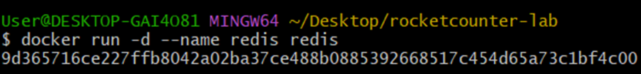

Создаем с rocketcounter

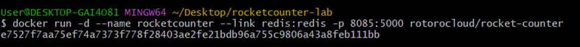

Проверка:

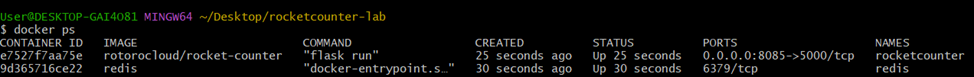

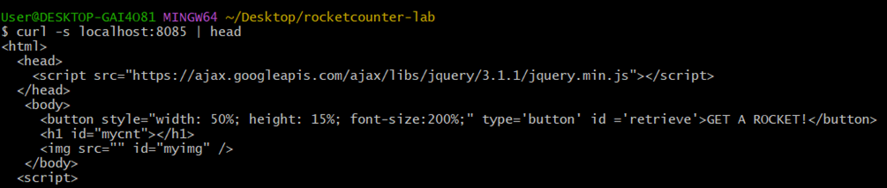 

Проверка в браузере

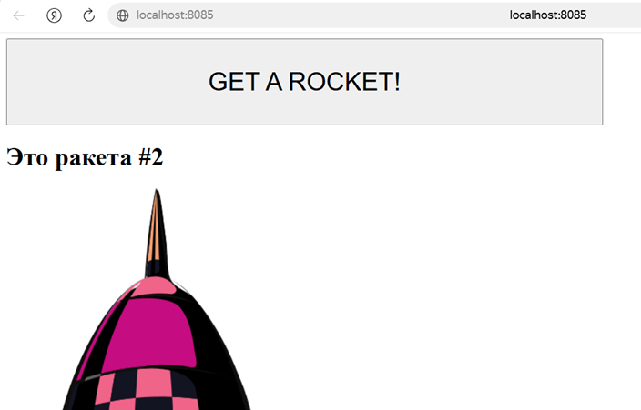

Удаляем:

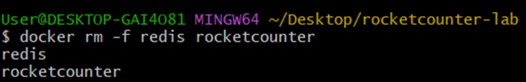

# Часть 2. Описание стека

Открываем блокнот

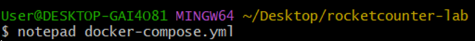

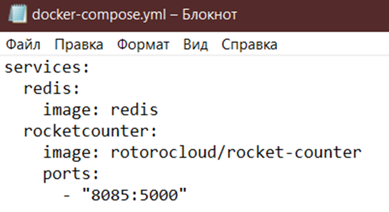
 
Запускаю стек

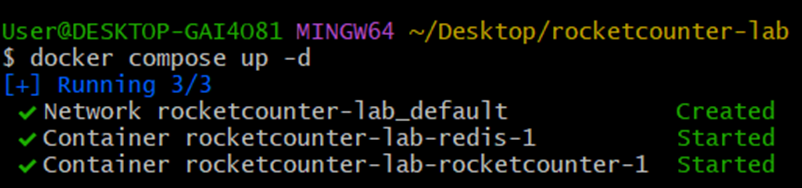

Проверка

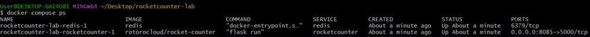

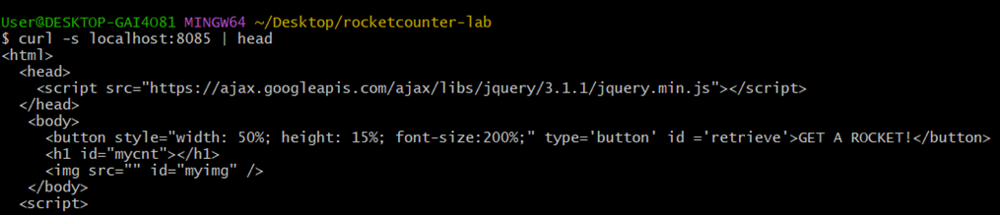
 

# Часть 3. Масштабирование приложения

В том же блокноте убираем привязку к порту

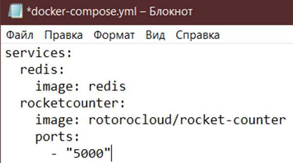

Масштабируем до 2

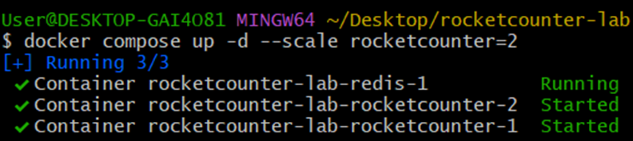

Проверка

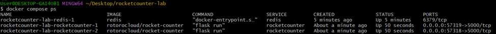

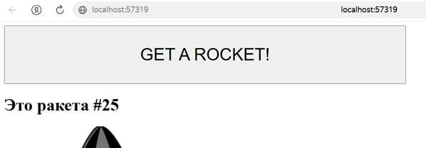

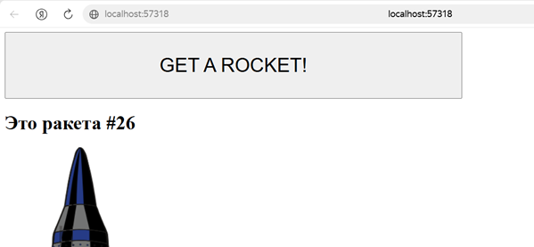
 
Одно и то же число на сайтах.

# Часть 4. Полное уничтожение стека
 
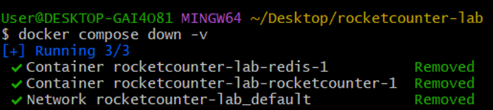

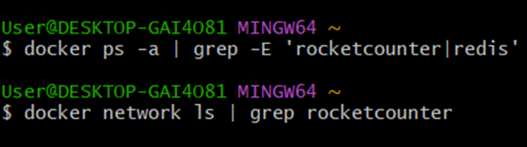

Вопросы
1.	Зачем в Ч.1 использовался --link и почему в Compose он не нужен?

это старый способ связать контейнеры, когда Docker не умел создавать общие сети. Он прописывает в hosts одного контейнера адрес другого. В Compose это не нужно, тк он сам создает общую сеть, кидает туда все сервисы, и они общаются по именам.

2.	Чем отличается image от build в Compose?

image - Docker возьмет готовый образ из Docker Hub
build - Docker будет собирать образ из Dockerfile

3.	Почему нельзя масштабировать сервис с публикацией фиксированного порта на одном хосте? Перечислите способы обойти это ограничение.

Потому что порт на хосте может быть занят только одним процессом. Если попытаться запустить две реплики с портом 8085, вторая просто упадет с ошибкой, что порт занят.

Способы обойти: 
* использовать динамические порты (Docker сам выберет свободный порт для каждой реплики) 
* использовать обратный прокси (nginx, Traefik), который распределяет трафик
* использовать Docker Swarm или Kubernetes.

4.	Что делает docker compose down -v и чем отличается от down без -v?

down останавливает и удаляет контейнеры и сети

down -v дополнительно удаляет volumes (тома), которые были созданы сервисами. 

5.	Как в Compose обеспечивается сетевое имя сервиса для обращения из другого сервиса?

Compose при запуске создает свою отдельную сеть и подключает к ней все контейнеры. Внутри этой сети работает Docker DNS, который понимает имена сервисов. Поэтому если в коде написать имя, он сам поймет, что это контейнер с базой, и найдет его.

